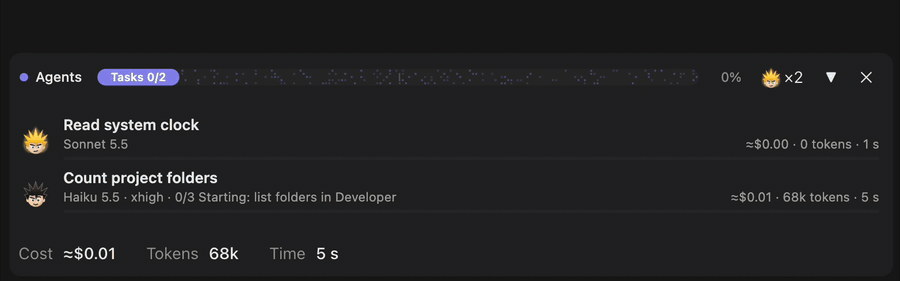
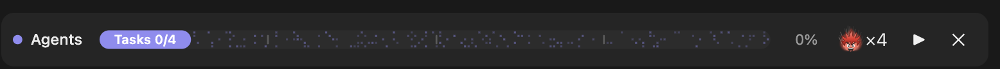
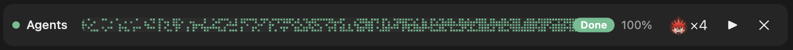
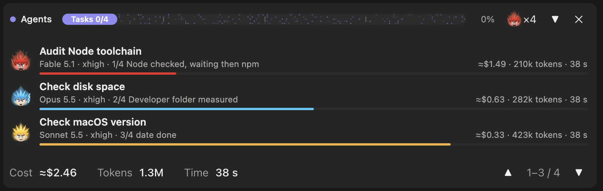
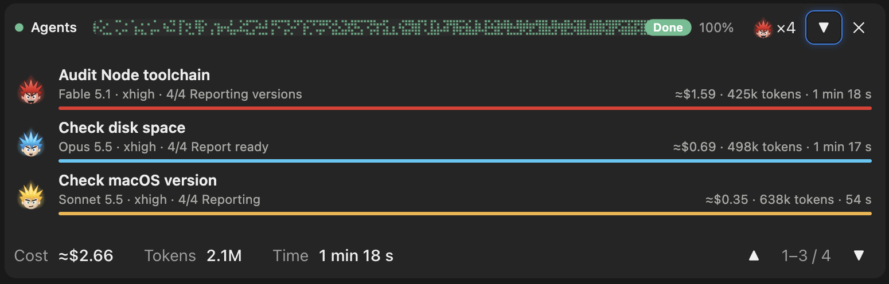

# SaiyanMod

A Claude Code mod (`agents-progress`): a progress bar above the prompt whenever subagents run, the list of subagents folded out under it, and a spiky-haired mascot per model that powers up from Haiku to Fable. Adapted from [savvy-progress](https://github.com/JohnnyVizz/claude-kit/tree/main/plugins/savvy-progress) by johnnyvizz (MIT), with the savvy-flow coupling removed.



Four subagents started one after the other, Haiku, Sonnet, Opus, then Fable: the head beside `×N` powers up as each stronger model joins. [Full-quality MP4](docs/demo.mp4).

## Screenshots

| | While the agents run | Once they are done |
| --- | --- | --- |
| **Collapsed** |  |  |
| **Unfolded** |  |  |

The bar wears the head of the strongest model of the turn (here Fable). Each head is animated while its agent works, then stands still with its aura dimmed.

## Install

At the prompt of a Claude Code terminal session:

```
/plugin install agents-progress --marketplace MHermand/SaiyanMod
```

From a shell:

```
claude plugin install agents-progress --marketplace MHermand/SaiyanMod
```

Answer `y` to add the marketplace, then pick a scope (the user scope comes first). In the desktop app, where `/plugin` does not run: click + next to the prompt box, then Plugins, Add marketplace with `MHermand/SaiyanMod`, then Add plugin. A mod installed at the user scope from a terminal also loads in the desktop app's local sessions.

## What it does

- **Progress bar**: appears as soon as a subagent starts and counts the batch, finished out of started. Once none runs, it turns green ("Done"); the next subagent starts a new batch. ✕ hides it; the next agent brings it back.
- **Mascot and count**: beside the bar, `×N` with the head of the strongest model among this turn's agents, finished or not.
- **Agents list**: the ▶ arrow beside ✕ (or `/agents-info`) folds it out under the bar: one compact row per subagent, newest first and three at a time, with its mascot, model, effort and steps, then cost, tokens and time; the bar under each row says whether it still runs. Under the rows, the turn's estimated cost, tokens and time, with ▲ ▼ to reach older agents. The list starts folded. Each prompt you send folds it and, once the next agent starts, keeps only the agents that were running when you sent it, plus the new ones.
- **Step reporting**: every subagent's brief gets one line asking it to report its steps with `mcp__agents-progress__step`, which draws its own bar in the list. A subagent that does not report shows its context fill in grey.
- **Mascot**: a spiky-haired head per model, animated while the agent runs and still, its aura dimmed, once done:
  - Haiku, Normal: black hair; breathing, blinking.
  - Sonnet, Charged: golden hair; slow golden aura, breathing, blinking, shine.
  - Opus, Super: blue hair; blue aura, bolts, shake, shine.
  - Fable, Ultimate: red hair; flaming aura, a halo of twinkling streaks, shake, hair in the wind, a flushing face, hair and aura turning red to orange.

  The motion stops when the system asks for reduced motion.

Cost is a rough estimate from token counts and the price table (`PRICES` in `hooks/register.tsx`), not a bill.

## Settings

In `/config`, or in `~/.claude/settings.json`:

- `language`: `auto` (follows Claude Code, then the system locale), `en`, `fr`, `ru` or `he`.
- `formHaiku`, `formSonnet`, `formOpus`, `formFable`: which head each model wears, `base`, `charged`, `super` or `ultimate`.

```json
{ "pluginConfigs": { "agents-progress": { "options": { "language": "fr", "formHaiku": "super" } } } }
```

## License

MIT. See [LICENSE](LICENSE).
