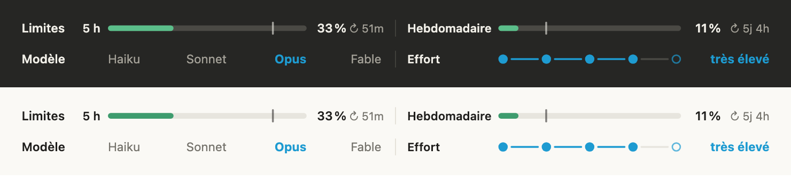

# SaiyanMod

Claude Code mods by MHermand.

## saiyan

One bar above the prompt with two views, your Claude plan's usage limits and the subagents' progress, and a spiky-haired mascot that wears the model and the effort you work with. A click on the mascot picks the model and the effort for your next message.



```
/plugin install saiyan --marketplace MHermand/SaiyanMod
```

Its screenshots, what it does and its settings: [saiyan/README.md](https://github.com/MHermand/SaiyanMod/tree/main/saiyan#readme).

It replaces agents-progress and usage-limits, the two mods this marketplace offered before; if you installed one, turn it off, or its band stacks with saiyan's. Its agents view is adapted from [savvy-progress](https://github.com/JohnnyVizz/claude-kit/tree/main/plugins/savvy-progress) by johnnyvizz (MIT).

## License

MIT. See [LICENSE](https://github.com/MHermand/SaiyanMod/blob/main/LICENSE).
