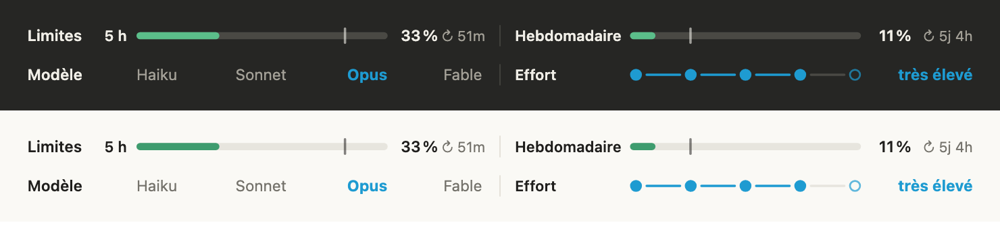
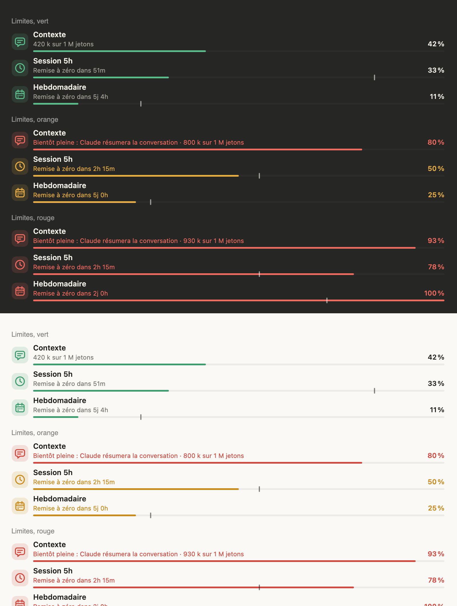
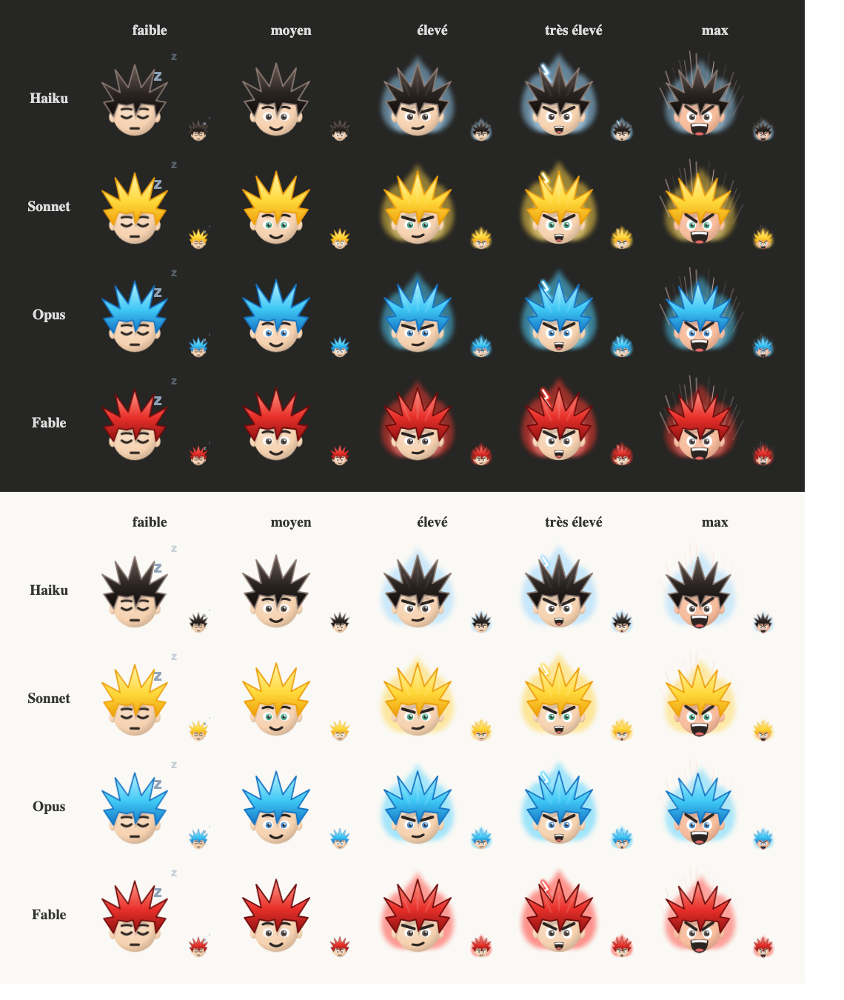

# saiyan

A Claude Code mod: one bar above the prompt with two views, your Claude plan's usage limits and the subagents' progress, and a spiky-haired mascot that wears the model and the effort you work with. A click on the mascot picks the model and the effort for your next message.

It replaces [agents-progress](https://github.com/MHermand/SaiyanMod#readme) and [usage-limits](https://github.com/MHermand/SaiyanMod/tree/main/usage-limits#readme): install one or the other, not both, or their bands stack.

## Screenshots

The bar folded, with the choice of model and effort open under it (dark, then light):



The limits view unfolded: the context, the 5-hour session and the week, green, amber and red:



The mascot for each model and effort, large and at the bar's size (still images: each head moves in the app):



## Install

At the prompt of a Claude Code terminal session:

```
/plugin install saiyan --marketplace MHermand/SaiyanMod
```

From a shell:

```
claude plugin install saiyan --marketplace MHermand/SaiyanMod
```

Answer `y` to add the marketplace, then pick a scope (the user scope comes first). In the desktop app, where `/plugin` does not run: click + next to the prompt box, then Plugins, Add marketplace with `MHermand/SaiyanMod`, then Add plugin. A mod installed at the user scope from a terminal also loads in the desktop app's local sessions.

If agents-progress or usage-limits is installed, turn it off:

```
claude plugin disable agents-progress@saiyan-mod
claude plugin disable usage-limits@saiyan-mod
```

## What it does

- **The bar** stands above the prompt from the session's start. ✕ puts it away until the next session; Ctrl+A or Option+A puts it away and brings it back. ⇄, before the fold toggle, switches between the two views; it stays dim until a subagent has run.
- **Limits view**, folded: `Limites`, then the 5-hour session and the week in two groups as wide, each with its bar, the percent used and the time until it resets. The thin mark on each bar is where a steady use of the window would stand now. Green while the bar is well before it, amber close to it, red past it (the limit comes before the reset) or once reached.
- **Limits view**, unfolded (▶): three blocks, the conversation's context (green under 60%, amber under 80%, red from 80%, with a warning that Claude will summarize the conversation), the 5-hour session and the week; under them, the session's estimated cost, its messages and its time. Toasts at 75% and 90% of a window, and when the pace will reach the limit before the reset.
- **Agents view**: a progress bar counting the steps of the batch's subagents, the strongest model's head and `×N`; unfolded, one row per subagent, three at a time, with its mascot, model, effort and steps, then cost, tokens and time. Each subagent is asked to report its steps with `mcp__saiyan__step`. A subagent starting brings this view up.
- **The mascot** at the left wears the session's model as its hair (Haiku black, Sonnet yellow, Opus blue, Fable red) and its effort as its face and motion: asleep under its z's at low, smiling at medium, a sure smile with a slow aura at high, a cry with bolts at extra high, all out at max (shaking, hair in the wind, flaming aura, a flushing face, twinkling streaks).
- **Choosing the model and the effort**: a click on the mascot opens a line under the bar, the models under the 5-hour window and the effort as five dots under the week. Your pick waits, line open or closed, and the mascot wears it; your next message goes on it from its first request, and the session keeps it after the answer. A slash command or an agent's notification leaves it waiting. Option+M and Option+E change the model and the effort at once, with a toast.
- **Language**: the flag at the foot of the unfolded bar cycles 🇺🇸 English, 🇫🇷 French and 🇪🇸 Spanish, remembered across sessions.

The limits come with Claude's replies on a Claude subscription (Pro, Max, Team); with an API key or a cloud provider there are none to show. Costs are estimates from token counts at API prices, not a bill. The motion stops when the system asks for reduced motion.

## Commands

- `/saiyan [usage|agents]`: shows the bar, on the view named.
- `/limits`: shows the limits view unfolded and prints the limits in the conversation.
- `/agents-info`: folds the agents list out or in.

## Settings

In `/config`, or in `~/.claude/settings.json`:

- `language`: the language before any flag is picked, `auto` (Claude Code's language when it is French or Spanish, else English), `en`, `fr`, `es`, `ru` or `he`. The limits view and the model choice speak English for `ru` and `he`.
- `alerts`: `on` or `off`, the usage toasts.
- `formHaiku`, `formSonnet`, `formOpus`, `formFable`: which form each model takes, `base` (black hair), `charged` (yellow), `super` (blue) or `ultimate` (red): its hair on the bar's mascot, its whole head and motion in the agents view.

```json
{ "pluginConfigs": { "saiyan": { "options": { "language": "fr", "alerts": "off" } } } }
```

## License

MIT. See [LICENSE](https://github.com/MHermand/SaiyanMod/blob/main/LICENSE).
